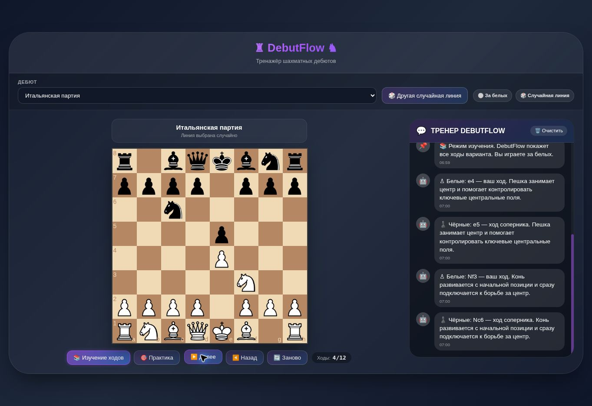
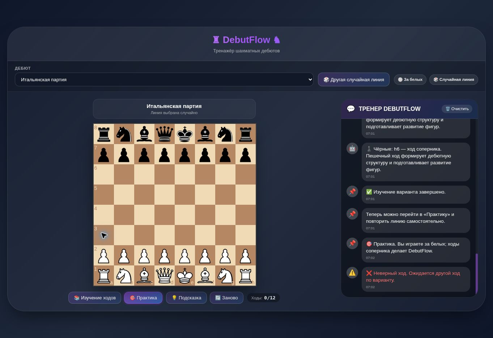
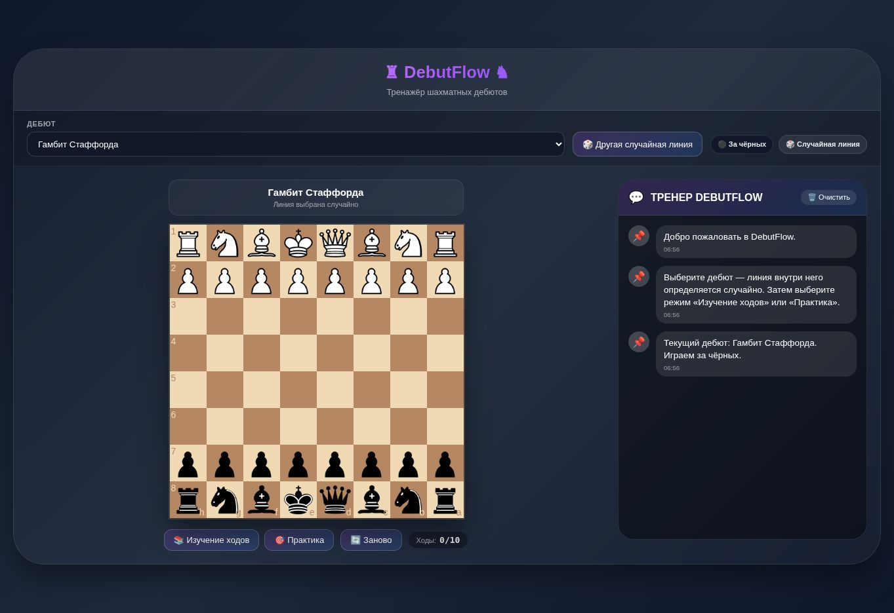
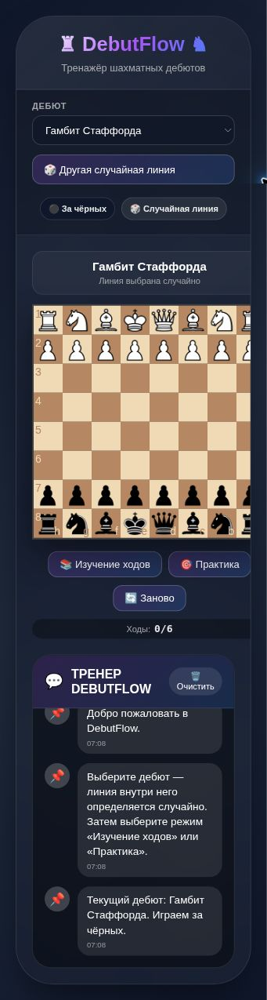

<div align="center">

# ♟️ DebutFlow

### Learn chess openings. Understand the ideas, not just the moves.

I built a small chess opening trainer where you can explore variations, practise them, and gradually learn **why each move makes sense**.

[**♟️ Try DebutFlow**](https://timsome1337.github.io/DebutFlow/) · [**View the code**](https://github.com/Timsome1337/DebutFlow)

[🇷🇺 Русский](README.md) &nbsp;·&nbsp; **🇬🇧 English**

   [](https://github.com/Timsome1337/DebutFlow/actions/workflows/tests.yml)

</div>

---

## Why I built it

When learning an opening, it's easy to memorise a sequence: knight here, bishop there, castle next. But I wanted to **understand the plan behind the moves** instead of playing them on autopilot.

That's why I made DebutFlow — a straightforward website where I can study an opening with explanations and then try to play it myself. No sign-up, subscription or unnecessary setup.

## A quick look

| Studying an opening | Practising a variation |
|:---:|:---:|
|  |  |
| Home screen | Narrow screen |
|  |  |

<sub>These screenshots are from an earlier interface version. Open the live demo above for the current build: the newer statistics and opening explanations are not shown in these captures. The narrow-screen screenshot was taken in browser emulation.</sub>

## What it can do

| | |
|---|---|
| ♟️ **23 opening sections, 227 lines** | Familiar openings and less common ideas. Some lines appear twice so you can train from both sides. |
| 📖 **Study mode** | Step through moves and read about the ideas behind them. |
| 🎯 **Practice mode** | Play the moves yourself and get feedback when you go off the line. |
| 💬 **Move explanations** | More detailed curated notes for five opening groups, with general explanations for the rest. |
| ⚪⚫ **Play both sides** | Train as White or Black. |
| 💡 **Hints** | Reveal the next move when you're stuck. |
| 📱 **Mobile and desktop** | Tap-to-move on touchscreens, drag-and-drop on desktop. |
| 💾 **Progress and stats** | The browser remembers your current session, completed lines and mistakes. |

## Give it a try

**[Open DebutFlow in your browser](https://timsome1337.github.io/DebutFlow/)**

Pick an opening and start training — no account required. Your progress stays in this browser, so clearing site data or switching browsers won't transfer it automatically.

## Under the hood

I kept the stack intentionally simple: **plain HTML, CSS and JavaScript**, with no build step or application server.

- **chess.js 0.10.3** handles move legality.
- **chessboard.js 1.0.0** renders the board; **jQuery 3.7.1** helps with the UI.
- **localStorage** saves the current variation and statistics (`debutflow.progress.v1`).
- **GitHub Pages** hosts the static site; **GitHub Actions** runs automated checks on updates.

The key files are `index.html`, `style.css`, `trainer.js`, `openings.js`, `comments.js` and `progress.js`. Check `tests/` for tests and `docs/screenshots/` for README images.

<details>
<summary><b>Run locally</b></summary>

You'll need Git, Python 3 and an internet connection for the external chess libraries:

```bash
git clone https://github.com/Timsome1337/DebutFlow.git
cd DebutFlow
python3 -m http.server 8000
```

Open `http://localhost:8000`.

</details>

<details>
<summary><b>Run the tests</b></summary>

Use Node.js 22 or 24. There's no need to install any npm packages.

```bash
node --check openings.js
node --check comments.js
node --check progress.js
node --check trainer.js
node --test tests/*.test.cjs
```

There's also a browser-based opening validator at `http://localhost:8000/tests/validate-pgn.html`. The goal is to check all 227 lines with no errors. Unit tests using a mocked chess engine **do not prove** every PGN is legal; the full real-browser result remains unconfirmed.

</details>

## What's next

I'd like to keep turning DebutFlow into a useful learning tool for people getting started with openings: clearer explanations, more exercises, and a smoother experience on mobile. For now, it's a personal project you can open and try.

---

<sub>Opening data was adapted from [lichess-org/chess-openings](https://github.com/lichess-org/chess-openings) (CC0). Third-party notices are in [THIRD_PARTY_NOTICES.md](THIRD_PARTY_NOTICES.md). No licence is granted for my original application code (all rights reserved): a public repository is not permission to redistribute or reuse the project. Full PGN browser validation and GitHub CI results need their own evidence beyond local unit tests.</sub>
