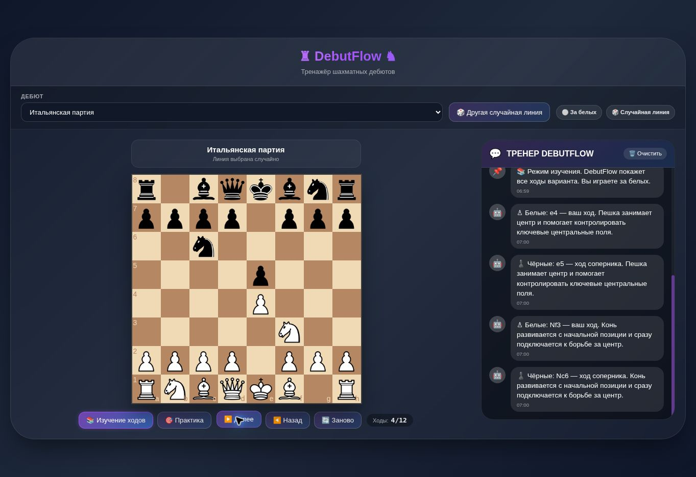
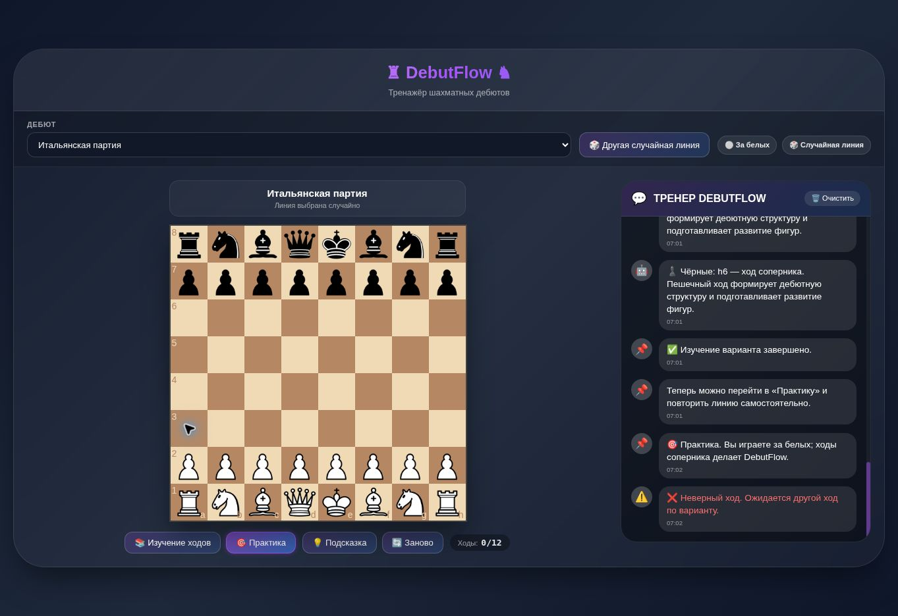
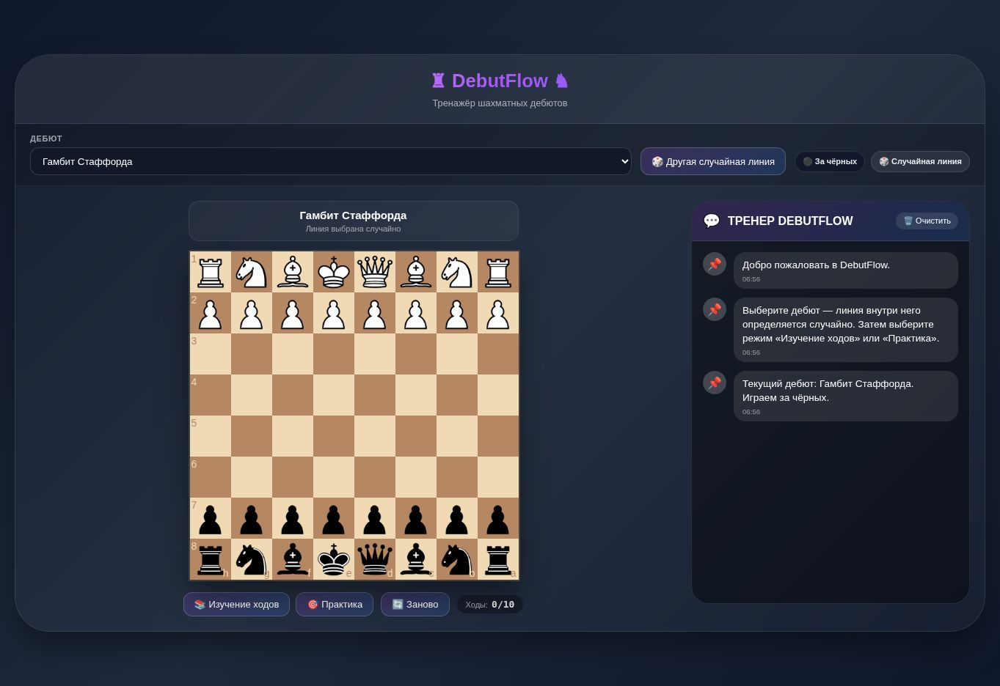
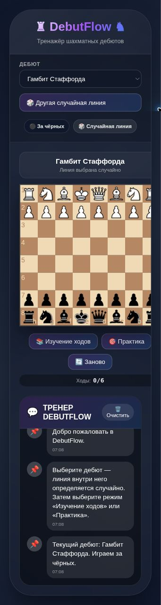

<div align="center">

# ♟️ DebutFlow

### Шахматные дебюты — не заучивать, а понимать.

Я сделал небольшой тренажёр, в котором можно разбирать дебюты, повторять варианты и постепенно запоминать, **зачем делается каждый ход**.

[**♟️ Открыть тренажёр**](https://timsome1337.github.io/DebutFlow/) · [**Посмотреть код**](https://github.com/Timsome1337/DebutFlow)

**🇷🇺 Русский** &nbsp;·&nbsp; [🇬🇧 English](README.en.md)

   [](https://github.com/Timsome1337/DebutFlow/actions/workflows/tests.yml)

</div>

---

## Зачем я сделал DebutFlow

Когда учишь шахматные дебюты, легко начать просто запоминать последовательность: сюда конь, сюда слон, потом рокировка. Но мне хотелось **понимать идею**, а не повторять ходы на автомате.

Поэтому я собрал DebutFlow — простой сайт, где можно сначала посмотреть вариант с объяснениями, а затем попробовать пройти его самостоятельно. Без регистрации, подписок и лишних экранов.

## Как это выглядит

| Изучение дебюта | Практика и проверка ходов |
|:---:|:---:|
|  |  |
| Главный экран | На узком экране |
|  |  |

<sub>На скриншотах — более ранняя версия интерфейса. Актуальную версию можно открыть по ссылке выше; новые счётчики статистики и обновлённые пояснения на этих изображениях ещё не показаны. Мобильный кадр сделан в эмуляции браузера.</sub>

## Что умеет тренажёр

| | |
|---|---|
| ♟️ **23 дебютных раздела, 227 линий** | От знакомых начал до менее очевидных вариантов. Некоторые линии повторяются для тренировки за обе стороны. |
| 📖 **Изучение** | Иду по ходам и читаю, в чём смысл позиции. |
| 🎯 **Практика** | Пробую сыграть линию сам; тренажёр подскажет, если ход не тот. |
| 💬 **Объяснения** | Для пяти групп дебютов я добавил более подробные комментарии; для остальных работают общие. |
| ⚪⚫ **Обе стороны** | Можно тренироваться за белых и за чёрных. |
| 💡 **Подсказки** | Если забыл продолжение, можно посмотреть следующий ход. |
| 📱 **Телефон и компьютер** | На телефоне — касания, на компьютере — перетаскивание фигур. |
| 💾 **Прогресс и статистика** | Сайт запоминает текущую тренировку, пройденные линии и ошибки в этом браузере. |

## Попробовать

**[Открыть DebutFlow в браузере](https://timsome1337.github.io/DebutFlow/)**

Можно сразу выбрать дебют и начать. Аккаунт не нужен. Прогресс хранится локально: если очистить данные сайта или открыть другой браузер, он не перенесётся автоматически.

## Как устроен проект

Я оставил всё максимально простым — обычные **HTML, CSS и JavaScript**, без сборщика и собственного сервера.

- **chess.js 0.10.3** проверяет шахматные ходы.
- **chessboard.js 1.0.0** отображает доску; **jQuery 3.7.1** помогает с интерфейсом.
- **localStorage** сохраняет текущую линию и статистику (`debutflow.progress.v1`).
- **GitHub Pages** публикует статический сайт; **GitHub Actions** автоматически запускает тесты после обновлений.

Все основные файлы лежат в корне: `index.html`, `style.css`, `trainer.js`, `openings.js`, `comments.js`, `progress.js`. В `tests/` — проверки, в `docs/screenshots/` — изображения для README.

<details>
<summary><b>Запустить у себя</b></summary>

Нужны Git, Python 3 и интернет для загрузки внешних библиотек:

```bash
git clone https://github.com/Timsome1337/DebutFlow.git
cd DebutFlow
python3 -m http.server 8000
```

Откройте `http://localhost:8000`.

</details>

<details>
<summary><b>Как проверить код</b></summary>

Понадобится Node.js 22 или 24. Устанавливать пакеты через npm не нужно.

```bash
node --check openings.js
node --check comments.js
node --check progress.js
node --check trainer.js
node --test tests/*.test.cjs
```

Дополнительно есть браузерная проверка шахматной базы: `http://localhost:8000/tests/validate-pgn.html`. Цель — проверить все 227 линий без ошибок. Автоматические тесты с заглушками **не заменяют** этой проверки на настоящей chess.js; полный результат браузерного валидатора пока не подтверждён.

</details>

## Что дальше

Хочу развивать DebutFlow как понятный тренажёр для тех, кто только разбирается в дебютах: делать объяснения полезнее, добавлять новые упражнения и улучшать удобство на телефоне. Пока это самостоятельный проект, который можно открыть и попробовать.

---

<sub>Данные дебютов адаптированы из [lichess-org/chess-openings](https://github.com/lichess-org/chess-openings) (CC0). Уведомления о сторонних библиотеках — в [THIRD_PARTY_NOTICES.md](THIRD_PARTY_NOTICES.md). Отдельная лицензия на мой код пока не предоставлена (all rights reserved): просмотр репозитория не означает разрешения копировать и распространять проект. Полноценная браузерная проверка всех PGN и запуск CI на GitHub должны подтверждаться отдельно, а не только локальными тестами.</sub>
